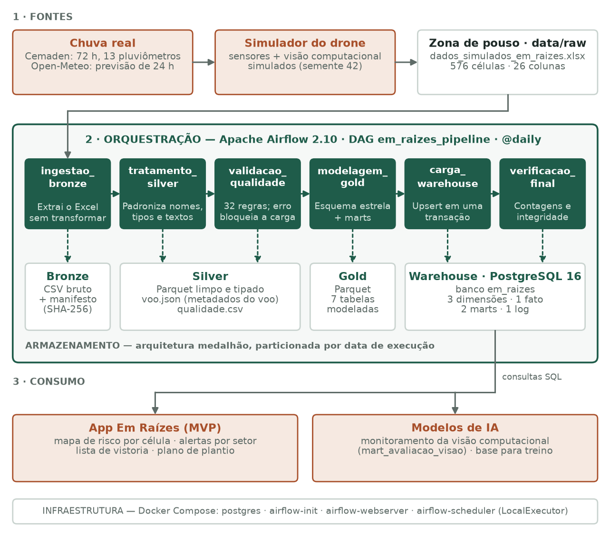

# Em Raízes — Pipeline de dados do MVP

Trabalho de **Big Data Architecture & Data Integration** (MVP CitizenTech).

O Em Raízes mapeia o risco de deslizamento em encostas ocupadas. Este repositório
entrega o componente **Dados** do MVP: um pipeline orquestrado no **Apache Airflow**
que leva o dado bruto do voo do drone até tabelas prontas para o app e para os
modelos de IA.



## O que o pipeline faz

| # | Tarefa no Airflow | O que faz | Saída |
|---|---|---|---|
| 1 | `ingestao_bronze` | Lê o Excel da fonte e grava as abas como CSV, sem transformar. Registra hash e horário. | `data/bronze/dt=AAAA-MM-DD/` |
| 2 | `tratamento_silver` | Padroniza nomes e tipos, converte Sim/Não em booleano, extrai os metadados do voo (chuva, semente, data). | `data/silver/dt=.../` |
| 3 | `validacao_qualidade` | Aplica 32 regras. Regra de severidade ERRO interrompe o pipeline antes da carga. | `qualidade.csv` |
| 4 | `modelagem_gold` | Monta o esquema estrela (3 dimensões, 1 fato) e 2 marts. | `data/gold/dt=.../` |
| 5 | `carga_warehouse` | Carrega no banco de forma idempotente, em uma transação. | 7 tabelas no PostgreSQL |
| 6 | `verificacao_final` | Confere contagens e integridade direto no banco. | log |

Tabelas entregues: `dim_voo`, `dim_setor`, `dim_celula`, `fato_medicao_celula`,
`mart_risco_setor`, `mart_avaliacao_visao`, `log_qualidade`.
Dicionário completo em [docs/dicionario_dados.md](docs/dicionario_dados.md).

## Sobre os dados

Os dados são **simulados de forma justificada**: o drone e o morro-piloto ainda não
existem, então um simulador (semente 42, reprodutível) gera o que o drone entregaria
para uma grade de 24 x 24 células de 10 m x 10 m. **A chuva é real**: acumulado de
72 h do Cemaden e previsão de 24 h do Open-Meteo para Petrópolis/RJ. Os pesos do
índice de risco são ilustrativos; os dados não servem para avaliar risco de verdade.

## Como executar

### Opção A — Airflow com Docker (a que vale para a entrega)

Pré-requisito: Docker Desktop (ou Docker Engine + Compose) com cerca de 4 GB de memória livres.

```bash
# só no Linux: faz os arquivos gerados pertencerem ao seu usuário
echo "AIRFLOW_UID=$(id -u)" > .env

docker compose up -d --build        # a primeira vez leva alguns minutos
docker compose ps                   # webserver e scheduler devem estar "running"
```

1. Abra <http://localhost:8080> e entre com `admin` / `admin`.
2. Ative o DAG `em_raizes_pipeline` (chave à esquerda do nome) e clique em **Trigger DAG** (▶).
3. Abra o DAG, aba **Graph**: as seis tarefas devem ficar verdes.
4. Clique em uma tarefa e depois em **Logs** para ver o que ela fez.

Conferir os dados carregados no PostgreSQL:

```bash
docker compose exec postgres psql -U emraizes -d em_raizes -c "\dt"
docker compose exec postgres psql -U emraizes -d em_raizes -c \
  "SELECT prioridade, setor, classe_setor, risco_medio_agora, moradores_em_risco_alto FROM mart_risco_setor ORDER BY prioridade;"
```

Mais consultas em [sql/consultas_exemplo.sql](sql/consultas_exemplo.sql).

Para desligar: `docker compose down` (acrescente `-v` para apagar também o banco).

### Opção B — sem Docker (teste rápido)

Roda as mesmas funções em sequência, sem Airflow, carregando em um SQLite local.

```bash
python -m venv .venv
source .venv/bin/activate            # Windows: .venv\Scripts\activate
pip install -r requirements.txt
python -m em_raizes.run_local
```

O banco fica em `data/warehouse/em_raizes.db`.

### Processar um novo voo

Substitua o arquivo em `data/raw/` e dispare o DAG de novo. Cada voo recebe um
`voo_id` próprio (data e hora da geração); o histórico anterior é preservado.
Reprocessar o mesmo voo não duplica linhas.

## Estrutura do repositório

```
dags/em_raizes_pipeline.py     DAG do Airflow (só orquestra)
em_raizes/                     lógica do pipeline
  config.py                      pastas e banco, via variáveis de ambiente
  bronze.py                      ingestão
  silver.py                      tratamento
  qualidade.py                   regras de qualidade
  gold.py                        modelagem dimensional
  carga.py                       carga e verificação no banco
  run_local.py                   execução sem Airflow
sql/ddl_warehouse.sql          CREATE TABLE das tabelas finais
sql/consultas_exemplo.sql      consultas que o app faz
data/raw/                      arquivo de origem (versionado)
data/bronze|silver|gold/       camadas geradas (não versionadas)
docs/                          diagramas, dicionário, PDF e evidências
docker-compose.yml, Dockerfile ambiente Airflow + PostgreSQL
```

## Documentação

- [docs/arquitetura_e_dicionario.pdf](docs/arquitetura_e_dicionario.pdf) — PDF entregue no portal.
- Para regerar (depois de preencher `EQUIPE` e `REPOSITORIO` no início do script):
  `python docs/gerar_documentacao.py`

## Evidências de execução

Em [docs/evidencias/](docs/evidencias/): log de uma execução completa do DAG e os
prints do Airflow e do banco.

## Equipe

- Carolina Cavalli Machado · RM552925
- Felipe Megumi Nakama · RM552821
- Luis Alberto Rocha Filho · RM553507
- Micael Santos Azarias · RM552699
